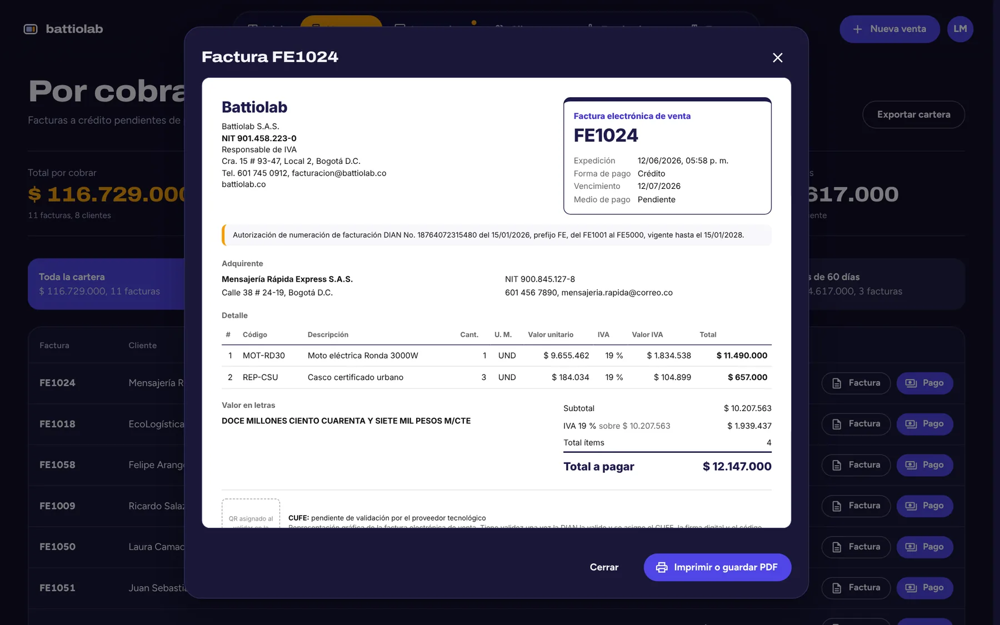
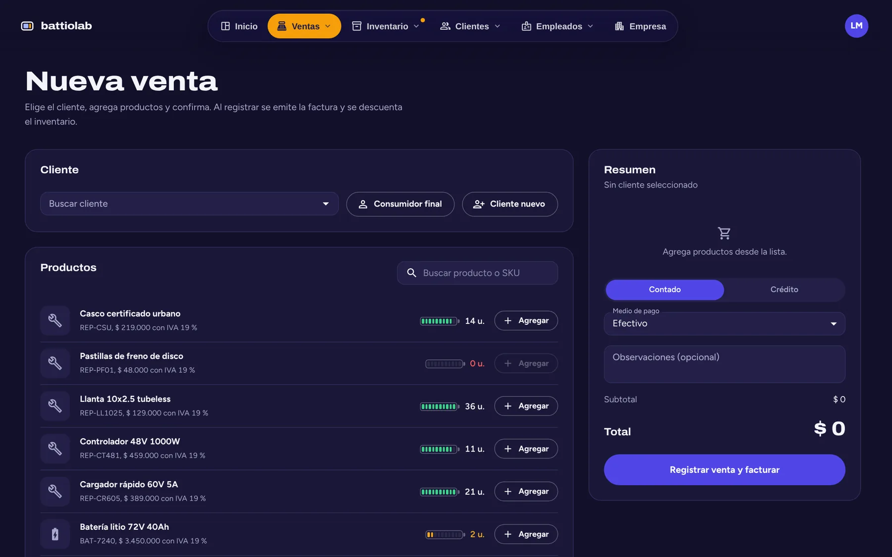
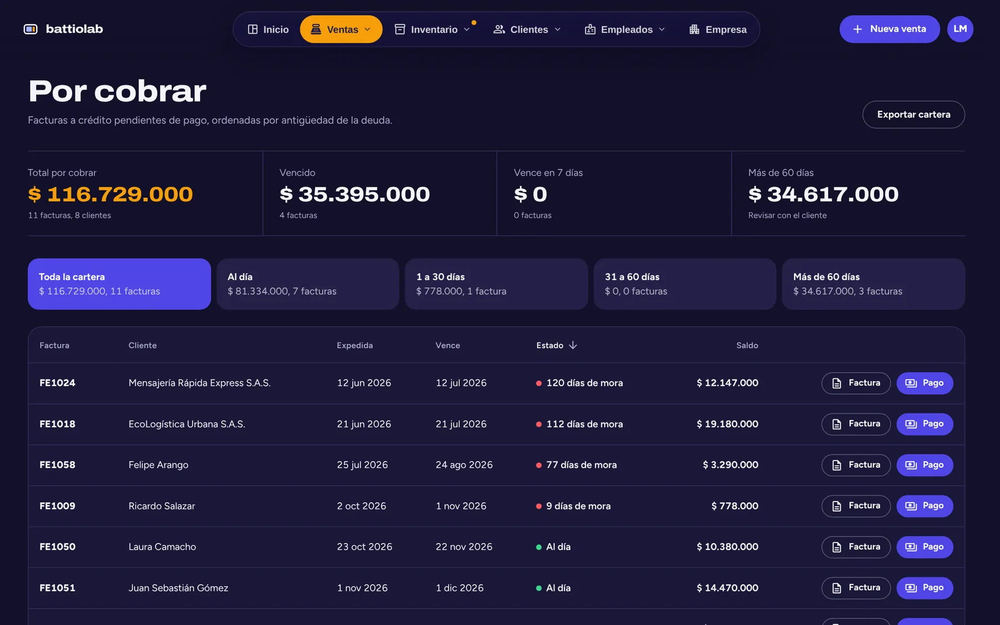
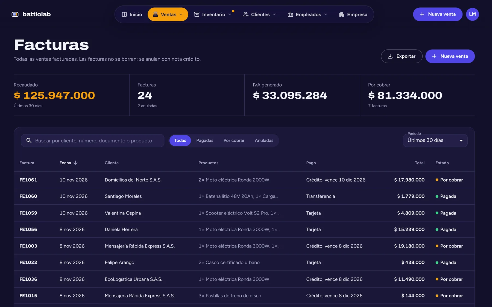
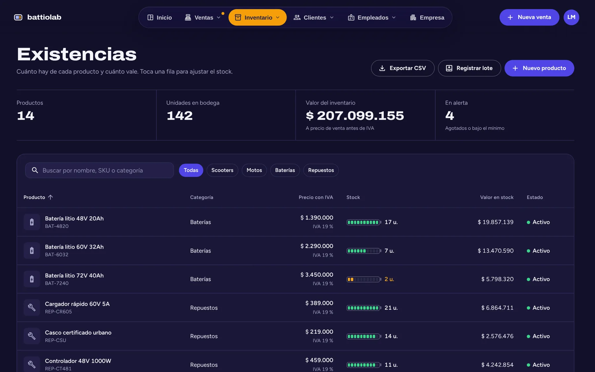
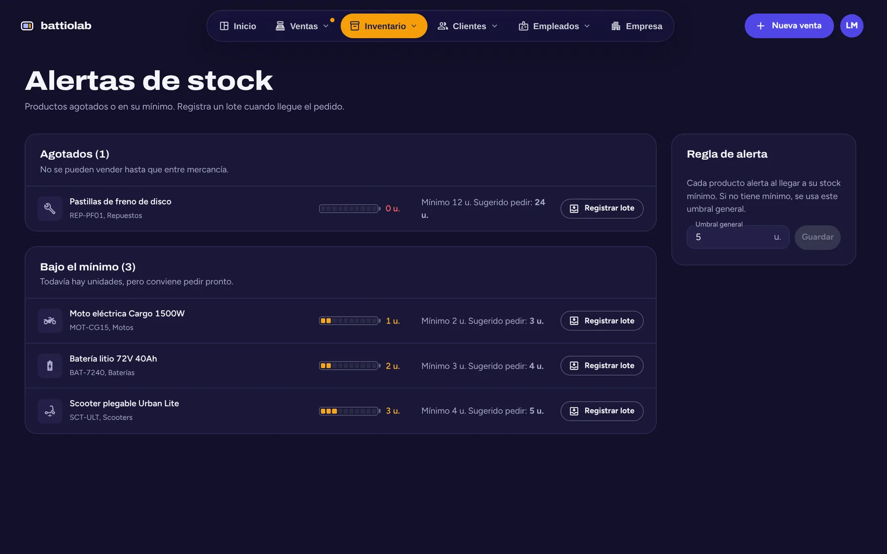
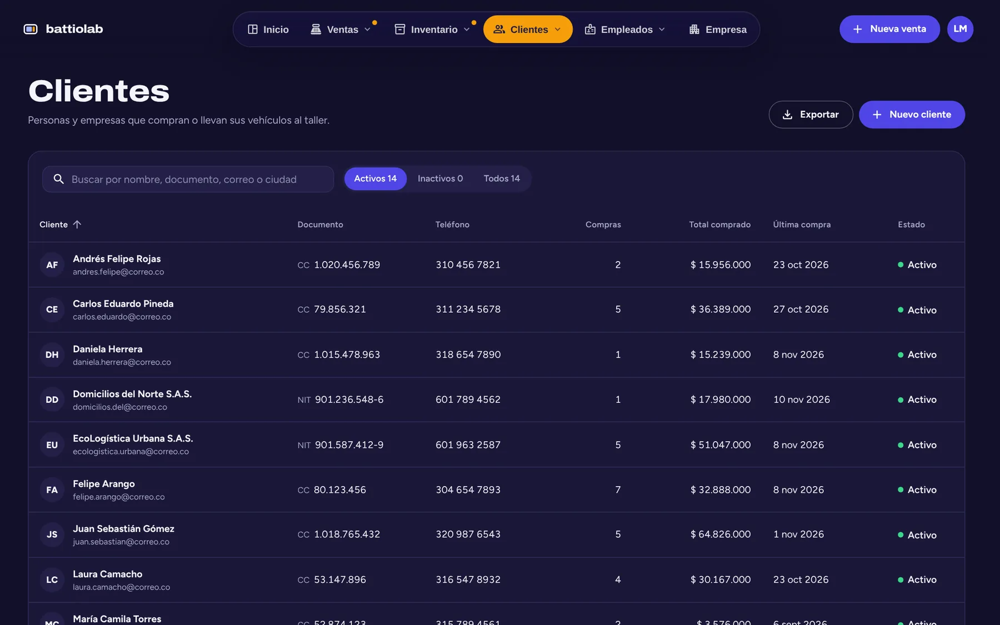
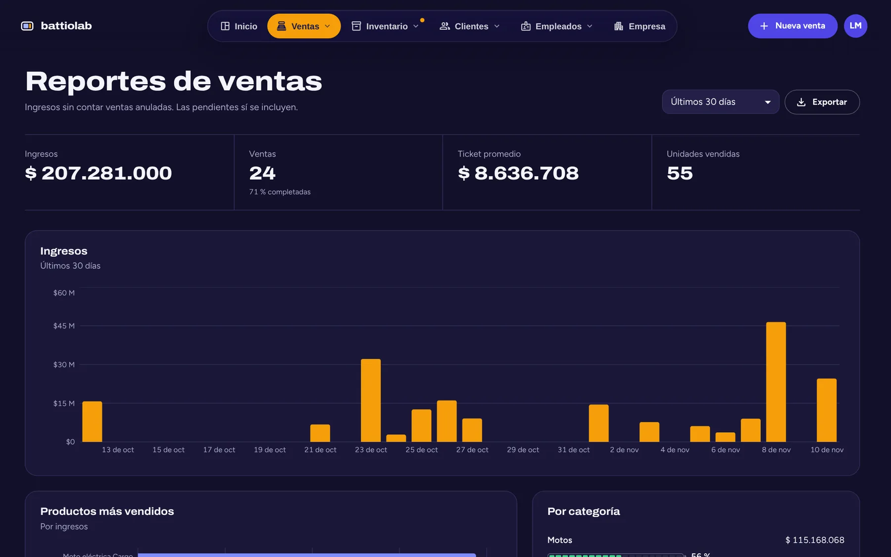
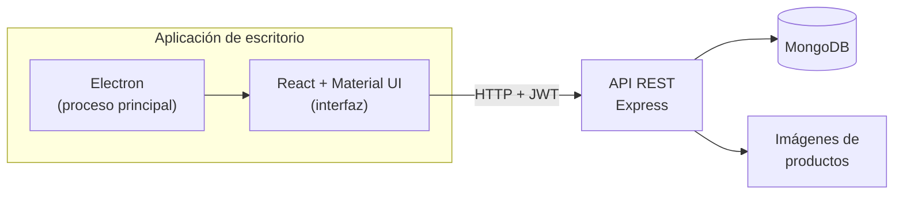

<p align="center">
  
</p>

---

## Contenido

- [Resumen](#resumen)
- [Capturas](#capturas)
- [Módulos](#módulos)
- [Reglas de negocio](#reglas-de-negocio)
- [Arquitectura](#arquitectura)
- [Instalación](#instalación)
- [Configuración](#configuración)
- [Ejecución](#ejecución)
- [Scripts](#scripts)
- [Estructura del proyecto](#estructura-del-proyecto)
- [Calidad](#calidad)
- [Tecnologías](#tecnologías)
- [Licencia](#licencia)

## Resumen

Battiolab es una aplicación de escritorio para la operación de una tienda y taller de vehículos eléctricos en Colombia. Centraliza ventas con facturación conforme a la normativa DIAN, inventario por lotes, cartera, clientes y nómina sobre una API REST con MongoDB.

Sitio del proyecto: **[bfailach.github.io/Battiolab](https://bfailach.github.io/Battiolab/)**

<p align="center">
  
</p>

## Capturas

Las capturas usan datos de demostración.

<table>
  <tr>
    <td width="50%"><br><sub><b>Factura de venta.</b> Resolución DIAN, IVA por tarifa y total en letras.</sub></td>
    <td width="50%"><br><sub><b>Nueva venta.</b> Contado o crédito, con validación de existencias.</sub></td>
  </tr>
  <tr>
    <td><br><sub><b>Cartera.</b> Saldos por antigüedad y registro de pagos.</sub></td>
    <td><br><sub><b>Facturas.</b> Recaudo, IVA generado y anulaciones.</sub></td>
  </tr>
  <tr>
    <td><br><sub><b>Existencias.</b> Nivel de stock y valor del inventario.</sub></td>
    <td><br><sub><b>Alertas de stock.</b> Agotados, bajo mínimo y cantidad sugerida.</sub></td>
  </tr>
  <tr>
    <td><br><sub><b>Clientes.</b> Personas naturales y jurídicas con historial.</sub></td>
    <td><br><sub><b>Reportes.</b> Ingresos, ticket promedio y ventas por categoría.</sub></td>
  </tr>
</table>

## Módulos

| Módulo | Alcance |
| --- | --- |
| Inicio | Ingresos del mes, ventas del día, cartera pendiente, carga del inventario y productos más vendidos. |
| Ventas | Facturas, nueva venta de contado o a crédito, consumidor final, cartera por antigüedad, reportes y configuración. |
| Inventario | Existencias, alertas de stock, catálogo con imágenes, lotes recibidos, historial de movimientos y escaneo de códigos. |
| Clientes | Directorio, segmentos (mejores, recurrentes, nuevos, sin actividad), historial de compras y reportes. |
| Empleados | Directorio, departamentos, reportes de nómina y antigüedad, retiros, cargos y áreas. |
| Empresa | Datos del emisor, resolución de facturación DIAN, pie de factura, UVT y salario mínimo. |

## Reglas de negocio

### Facturación

- Cada venta emite una factura con los requisitos del art. 617 del Estatuto Tributario y del art. 11 de la Resolución DIAN 000165 de 2023 que dependen del sistema: emisor con NIT y DV, calidad tributaria, resolución con prefijo, rango y vigencia, adquirente o consumidor final (`222222222222`), detalle con unidad de medida, IVA discriminado por tarifa, total en letras, forma y medio de pago.
- Con resolución registrada, la numeración usa su prefijo y rango. El sistema rechaza facturar fuera del rango o con la resolución vencida.
- Las facturas son inmutables: se anulan con nota crédito, con motivo y consecutivo propio, y el inventario se repone.
- El IVA se define por producto: 19 %, 5 % o excluido. Si el precio incluye IVA, la factura desagrega la base para que el total coincida.
- Las ventas a crédito exigen un cliente identificado y generan fecha de vencimiento según los días de crédito configurados.

> [!NOTE]
> Battiolab no transmite documentos a la DIAN. El CUFE, la firma digital y el código QR los asigna un proveedor tecnológico autorizado.

### Inventario

- Cada venta descuenta stock. La venta sin existencias está bloqueada salvo que se habilite en Configuración de ventas.
- Los lotes suman stock con costo, proveedor y garantía. Todo cambio de existencias queda en el historial de movimientos.
- Un producto con ventas o lotes no se elimina: se descontinúa.

### Clientes, empleados y usuarios

- Los clientes se desactivan, no se eliminan. A los empleados se les registra la fecha y el motivo del retiro.
- Validaciones colombianas: cédula de 6 a 10 dígitos, NIT de 9 dígitos con dígito de verificación calculado, teléfonos de 10 dígitos (celular 3xx o fijo 601 a 608) y SKU en mayúsculas.
- La primera cuenta registrada es administradora. Solo los administradores modifican la configuración.

## Arquitectura



- La interfaz corre aislada (`contextIsolation: true`, `nodeIntegration: false`) y solo se comunica con la API.
- La API valida cada operación y aplica las reglas de negocio en el servidor: totales, IVA, numeración, stock y permisos.
- La autenticación usa JWT y contraseñas con hash bcrypt.

## Instalación

Requisitos: Node.js 18 o superior y MongoDB 6 o superior, local o remoto.

```bash
git clone https://github.com/bfailach/Battiolab.git
cd Battiolab
npm install
npm install --prefix server
cp server/.env.example server/.env
```

## Configuración

Variables de `server/.env`:

| Variable | Requerida | Descripción |
| --- | --- | --- |
| `MONGODB_URI` | Sí | Cadena de conexión a MongoDB. |
| `JWT_SECRET` | Sí | Clave para firmar las sesiones. Debe ser una cadena larga y aleatoria. |
| `PORT` | No | Puerto de la API. Por defecto `3006`. |
| `SITE_CODE` | No | Si se define, el registro exige este código de sede. |
| `CORS_ORIGINS` | No | Orígenes permitidos, separados por comas. |
| `UPLOAD_DIR` | No | Carpeta de imágenes de productos. Por defecto `server/uploads`. |

## Ejecución

Con MongoDB en ejecución:

```bash
npm run app   # compila la interfaz, inicia la API y abre la aplicación
npm run dev   # modo desarrollo con recarga en caliente
```

Ambos comandos inician la API en `http://localhost:3006`.

## Scripts

| Comando | Descripción |
| --- | --- |
| `npm run app` | Compila la interfaz, inicia la API y abre la aplicación. |
| `npm run dev` | API, servidor de desarrollo de React y Electron en paralelo. |
| `npm run build` | Build de producción de la interfaz en `build/`. |
| `npm test` | Pruebas de la API y del proceso principal de Electron. |
| `npm run coverage` | Pruebas con reporte de cobertura en `coverage/`. |
| `npm run lint` | Análisis estático con ESLint. |
| `npm run format` | Formato con Prettier. |

## Estructura del proyecto

```text
Battiolab/
├── main.js            Proceso principal de Electron
├── public/            HTML base, ícono y manifiesto
├── src/               Interfaz (React + TypeScript)
│   ├── components/    Módulos: sales, inventory, clients, employees, company
│   ├── contexts/      Sesión y estado de la interfaz
│   ├── services/      Clientes de la API por módulo
│   └── utils/         Formato, validaciones, CSV y total en letras
├── server/            API REST (Express + Mongoose)
│   ├── models/        Producto, Venta, Lote, Cliente, Empleado, Usuario, Configuración
│   ├── routes/        Endpoints por módulo
│   ├── services/      Lógica de stock
│   └── utils/         Validadores y manejo de errores
├── site/              Sitio del proyecto (GitHub Pages)
├── tests/             Pruebas con Jest y Supertest
└── docs/              Plan de calidad, capturas y recursos gráficos
```

## Calidad

- **Integración continua:** cada push y pull request a `master` ejecuta auditoría de dependencias, lint, pruebas con cobertura y build en GitHub Actions.
- **Dependencias:** Dependabot propone actualizaciones automáticas.
- **Plan de calidad:** métricas y objetivos basados en ISO/IEC 25010 en [`docs/qaplan.md`](docs/qaplan.md).

## Tecnologías

| Capa | Herramientas |
| --- | --- |
| Escritorio | Electron 45 |
| Interfaz | React 18, TypeScript, Material UI 5, Recharts, React Router 6 |
| API | Node.js, Express 4, Mongoose 7, JWT, bcrypt |
| Datos | MongoDB |
| Calidad | Jest, Supertest, ESLint, Prettier, GitHub Actions |

Las tipografías Archivo y Figtree se distribuyen con la aplicación.

## Licencia

Distribuido bajo la licencia ISC. Ver [`LICENSE`](LICENSE).

<p align="center"><sub>Desarrollado por <a href="https://github.com/bfailach">Bryan Failach</a></sub></p>
