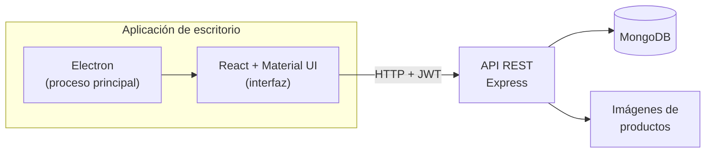

<p align="center">
  
</p>

---

## Contenido

- [Características](#características)
- [Reglas de negocio](#reglas-de-negocio)
- [Arquitectura](#arquitectura)
- [Primeros pasos](#primeros-pasos)
- [Scripts](#scripts)
- [Estructura del proyecto](#estructura-del-proyecto)
- [Calidad](#calidad)
- [Tecnologías](#tecnologías)
- [Licencia](#licencia)

## Características

| Módulo | Qué incluye |
| --- | --- |
| **Inicio** | Ingresos del mes, carga del inventario, ventas recientes y productos más vendidos |
| **Ventas** | Facturas, nueva venta (contado o crédito, consumidor final), cartera por antigüedad, reportes y configuración |
| **Inventario** | Existencias, alertas de stock, catálogo con imágenes, lotes recibidos y escaneo de códigos |
| **Clientes** | Directorio, segmentos (mejores, recurrentes, nuevos, sin actividad), historial de compras y reportes |
| **Empleados** | Directorio, departamentos, reportes de nómina y antigüedad, retiros, cargos y áreas |
| **Empresa** | Datos del emisor, resolución de facturación DIAN, pie de factura, UVT y salario mínimo |

## Reglas de negocio

<details open>
<summary><b>Facturación</b></summary>

- Cada venta emite una factura con los requisitos del art. 617 del Estatuto Tributario y del art. 11 de la Resolución DIAN 000165 de 2023 que dependen del sistema: emisor con NIT y DV, calidad tributaria, resolución con prefijo, rango y vigencia, adquirente (o consumidor final `222222222222`), detalle con unidad de medida, IVA discriminado por tarifa, total en letras, forma y medio de pago.
- Con resolución registrada se usa su prefijo y rango; no se factura fuera del rango ni con la resolución vencida.
- Las facturas no se editan ni se borran: se anulan con nota crédito (con motivo y consecutivo propio) y el inventario se repone.
- IVA por producto: 19 %, 5 % o excluido. El precio puede escribirse con IVA incluido y la factura desagrega la base para que el total sea exacto.

> [!NOTE]
> Battiolab no transmite a la DIAN. El CUFE, la firma digital y el código QR los asigna un proveedor tecnológico autorizado.

</details>

<details>
<summary><b>Inventario</b></summary>

- Vender descuenta stock y no se permite vender sin existencias, salvo que se active en Configuración de ventas.
- Los lotes suman stock y cada cambio queda en el historial de movimientos.
- Los productos con ventas o lotes no se eliminan: se descontinúan.

</details>

<details>
<summary><b>Clientes, empleados y usuarios</b></summary>

- Los clientes no se eliminan, se desactivan. A los empleados se les registra el retiro.
- Validaciones colombianas: cédula de 6 a 10 dígitos, NIT de 9 dígitos con dígito de verificación automático, teléfonos de 10 dígitos (celular 3xx o fijo 601 a 608) y SKU en mayúsculas.
- La primera cuenta registrada es administradora. Solo los administradores cambian la configuración.

</details>

## Arquitectura



La interfaz corre aislada (`contextIsolation`, sin `nodeIntegration`) y se comunica solo con el API, que valida cada operación y aplica las reglas de negocio.

## Primeros pasos

### Requisitos

- Node.js 18 o superior
- MongoDB 6 o superior, local o remoto

### Instalación

```bash
git clone https://github.com/bfailach/Battiolab.git
cd Battiolab
npm install
npm install --prefix server
cp server/.env.example server/.env   # edita JWT_SECRET antes de continuar
```

### Configuración

Variables de `server/.env`:

| Variable | Requerida | Descripción |
| --- | :---: | --- |
| `PORT` | | Puerto del API (por defecto `3006`) |
| `MONGODB_URI` | ✓ | Cadena de conexión a MongoDB |
| `JWT_SECRET` | ✓ | Clave para firmar las sesiones; usa una cadena larga y aleatoria |
| `SITE_CODE` | | Si se define, el registro exige este código de sede |
| `CORS_ORIGINS` | | Orígenes permitidos, separados por comas |
| `UPLOAD_DIR` | | Carpeta de imágenes de productos (por defecto `server/uploads`) |

### Ejecución

Con MongoDB encendido:

```bash
npm run app   # compila la interfaz y abre la aplicación (uso diario)
npm run dev   # modo desarrollo con recarga al guardar
```

Ambos comandos levantan también el API en `http://localhost:3006`. Para detener todo, cierra la ventana o presiona `Ctrl+C`.

## Scripts

| Comando | Descripción |
| --- | --- |
| `npm run app` | Compila la interfaz, inicia el API y abre la aplicación |
| `npm run dev` | API, servidor de desarrollo de React y Electron en paralelo |
| `npm run build` | Build de producción de la interfaz en `build/` |
| `npm test` | Pruebas del API y del proceso de Electron |
| `npm run coverage` | Pruebas con reporte de cobertura en `coverage/` |
| `npm run lint` | Análisis estático con ESLint |
| `npm run format` | Formato con Prettier |

## Estructura del proyecto

```text
Battiolab/
├── main.js                 # Proceso principal de Electron
├── public/                 # HTML base, ícono y manifiesto
├── src/                    # Interfaz (React + TypeScript)
│   ├── components/         # Módulos: sales, inventory, clients, employees, company…
│   ├── contexts/           # Sesión y estado de la interfaz
│   ├── services/           # Clientes del API por módulo
│   └── utils/              # Formato, validaciones, CSV, total en letras
├── server/                 # API REST (Express + Mongoose)
│   ├── models/             # Producto, Venta, Lote, Cliente, Empleado, Usuario…
│   ├── routes/             # Endpoints por módulo
│   ├── services/           # Lógica de stock
│   └── utils/              # Validadores y manejo de errores
├── tests/                  # Pruebas con Jest y Supertest
└── docs/                   # Plan de calidad y recursos
```

## Calidad

- **Integración continua:** cada push y pull request a `master` ejecuta auditoría de dependencias, lint, pruebas con cobertura y build en GitHub Actions.
- **Dependencias:** Dependabot propone actualizaciones de forma automática.
- **Plan de calidad:** métricas y objetivos basados en ISO/IEC 25010 en [`docs/qaplan.md`](docs/qaplan.md).

## Tecnologías

| Capa | Herramientas |
| --- | --- |
| Escritorio | Electron 45 |
| Interfaz | React 18, TypeScript, Material UI 5, Recharts, React Router 6 |
| API | Node.js, Express 4, Mongoose 7, JWT, bcrypt |
| Datos | MongoDB |
| Calidad | Jest, Supertest, ESLint, Prettier, GitHub Actions |

Tipografías Archivo y Figtree incluidas en la aplicación.

## Licencia

Distribuido bajo la licencia ISC. Consulta [`LICENSE`](LICENSE).

<p align="center"><sub>Desarrollado por <a href="https://github.com/bfailach">Bryan Failach</a></sub></p>
